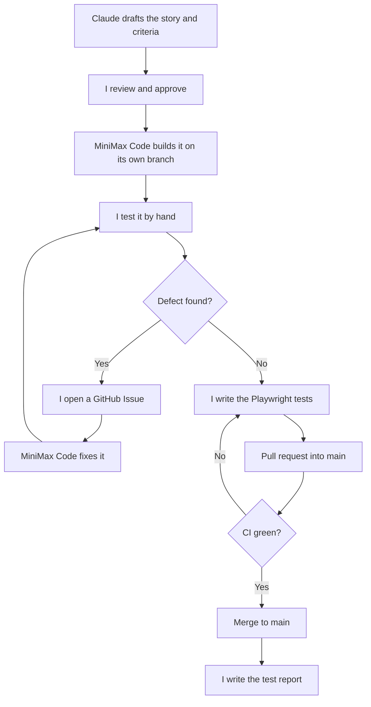
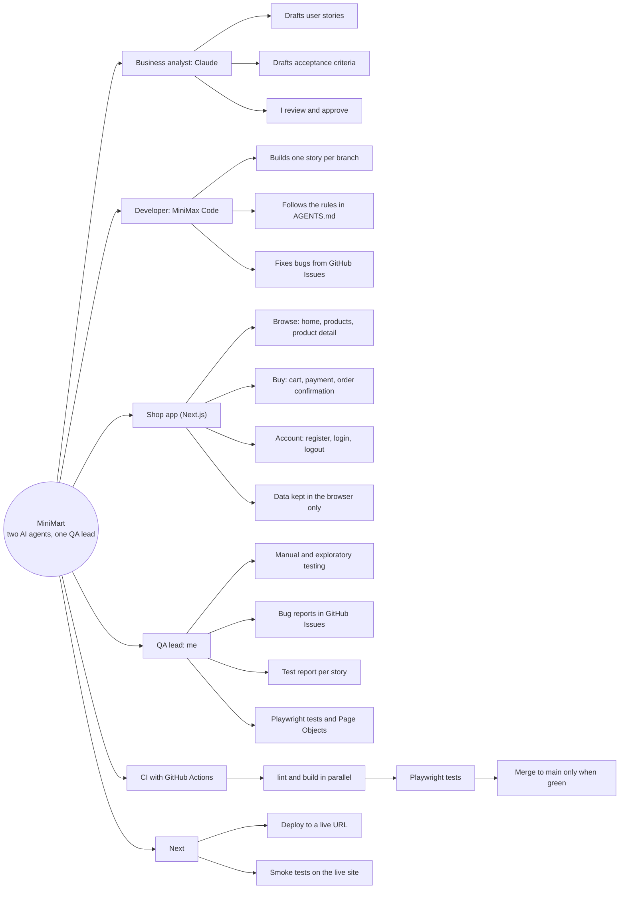
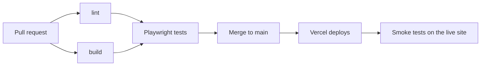

# MiniMart: an AI-built online shop that I test


**Live demo:** https://ai-built-shop-qa.vercel.app

MiniMart is a small online shop built with Next.js, made by a small team of two AI agents and me. MiniMax Code is the developer: it writes all the application code. Claude is the business analyst: it drafts the user stories and acceptance criteria with me. I'm the QA lead: I review and approve the stories, test every one of them, report bugs, write the Playwright tests and decide whether a story is accepted.

It's a mock shop. There are no real payments, no real customer data and no database.

## How each feature gets built

1. Claude, as business analyst, drafts a user story with numbered acceptance criteria, and I review, change and approve it (`docs/user-stories.md`).
2. The agent builds that story and nothing else, on its own branch, following the rules in `AGENTS.md`.
3. I test it by hand. That means every criterion, then my own exploratory checks: edge cases, keyboard use, small screens, console errors.
4. Any defect becomes a GitHub Issue. The agent fixes it and I retest.
5. I write the Playwright tests and run the whole suite to catch regressions.
6. I open a pull request. I merge only when the pipeline is green.
7. I write a short test report for the story in `docs/test-report-storyN.md`.



## What is built

| Story | Feature | Status |
|---|---|---|
| 1 | Project setup, home page, header, footer, 404 page | Done |
| 2 | Product list (12 products) | Done |
| 3 | Product detail page with size and quantity | Done |
| 4 | Add to cart and cart badge (shows `99+` above 99) | Done |
| 5 | Cart page: change quantities, remove items | Done |
| 6 | Order summary and checkout link | Done |
| 7 | Registration with demo accounts that expire after 24 hours | Done |
| 8 | Login and logout | Done |
| 9 | Automatic login after registration | Done |
| 10 | Checkout gate: `/payment` requires login | Done |
| 11 | Notifications (toasts) | Done |
| 12 | Payment form | Done |
| 13 | Order confirmation, cart emptied after the order | Done |

The full acceptance criteria are in [`docs/user-stories.md`](docs/user-stories.md).

## Project Map



## How I test

Every test traces back to an acceptance criterion. Beyond the criteria, I look at boundaries (quantity 1 and 10, a badge at 99 and at 100), invalid input, the browser back button, a second tab, screen widths of 375px and 1440px, and keyboard-only use.

The automated tests use Playwright with JavaScript and the Page Object Model. Each test starts with an empty browser, so tests never depend on each other.

The 24-hour account expiry would be painful to test in real time, so the tests move the browser clock forward with Playwright's `page.clock`.

The agent isn't allowed to touch `tests/` or `pages-objects/`, and I treat its own checks as claims until I've verified them myself. When I wanted registration to log the user in automatically, I didn't call it a bug. The current behavior matched Story 7, so I wrote a new story (Story 9) instead of editing history.

## Continuous integration

## Continuous integration

Two GitHub Actions workflows protect `main`.

`.github/workflows/playwright.yml` runs on every pull request and every push to `main`. `lint` and `build` run in parallel, then the Playwright tests run. I merge only when it is green.

`.github/workflows/live-smoke.yml` runs after the CI pipeline succeeds on `main`. It runs the `@smoke` tests against the live site.



## Run it locally

You need Node.js 20.9 or newer (22 LTS is better) and npm 10 or newer.

```bash
npm install
npm run dev
```

Open http://localhost:3000. For a production build:

```bash
npm run build
npm run start
```

## Run the tests

```bash
npx playwright install chromium   # first time only
npx playwright test               # starts the app by itself
npx playwright show-report
```

To run a single file:

```bash
npx playwright test tests/cart.spec.js
```

To simulate CI on your machine (PowerShell):

```powershell
$env:CI="true"; npx playwright test
```

To reset the app by hand, clear the site data in your browser (F12, Application, Clear site data).

## Project structure

```
src/                 Application code (AI-generated)
public/products/     Product images (SVG)
tests/               Playwright specs (mine)
pages-objects/       Page Object classes (mine)
docs/                Project brief, user stories, test reports
.github/workflows/   CI pipeline
AGENTS.md            Rules the AI agent follows
```

## Locators

The app uses `data-testid` attributes so tests don't depend on styling. The agreed names are listed in [`AGENTS.md`](AGENTS.md), for example `nav-cart`, `cart-badge`, `product-card`, `add-to-cart`, `cart-total` and `proceed-to-checkout`. In the tests I prefer `getByTestId` and role-based locators.

## Limitations

- Demo accounts and the cart live in the browser's `localStorage`, and the login session lives in `sessionStorage`. Passwords are stored in plain text because this is a mock, so please don't enter a real one. Accounts are deleted 24 hours after they are created.
- The live smoke tests start when the CI pipeline finishes, while Vercel deploys in parallel. They check that the live site answers, not that it is the newest version, so a very slow deployment could be tested at its previous version.

## More documents

- [`docs/project-brief.md`](docs/project-brief.md): scope and Definition of Done
- [`docs/user-stories.md`](docs/user-stories.md): stories and acceptance criteria
- `docs/test-report-story1.md` onward: test results for each story